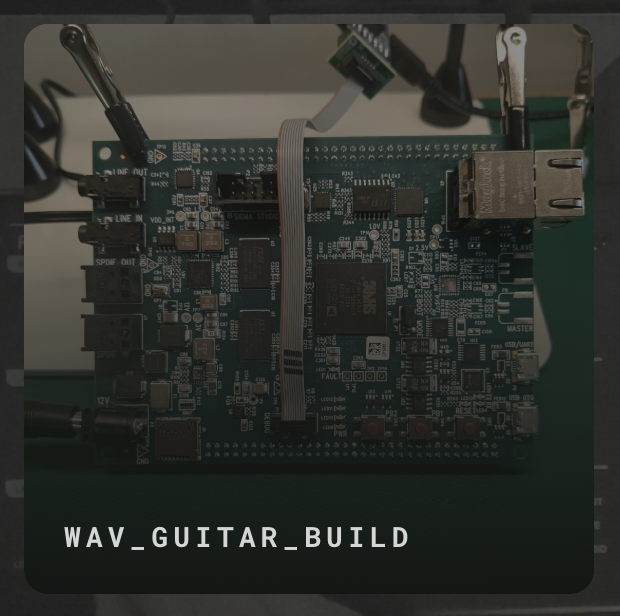
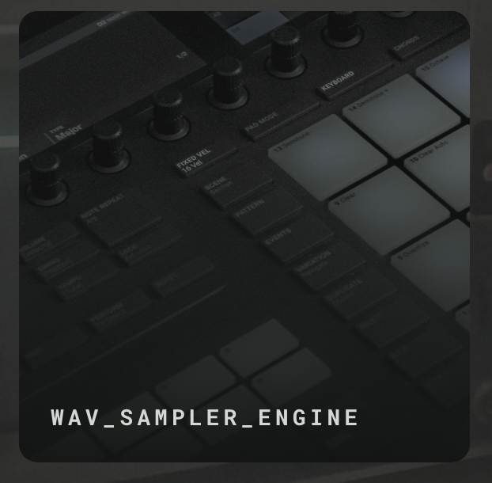
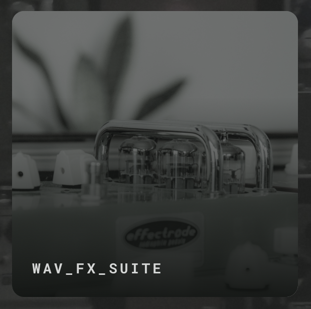
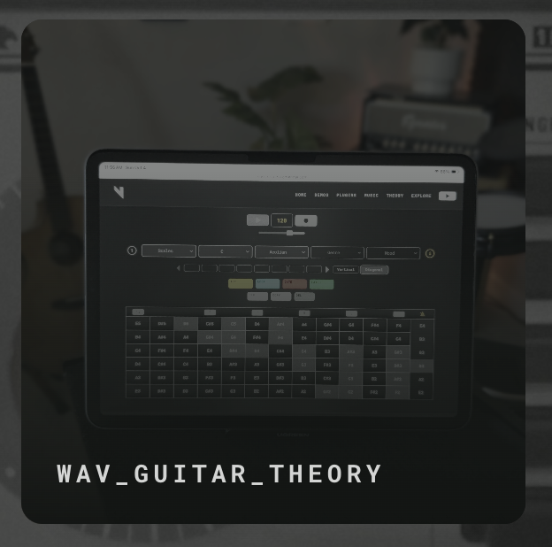
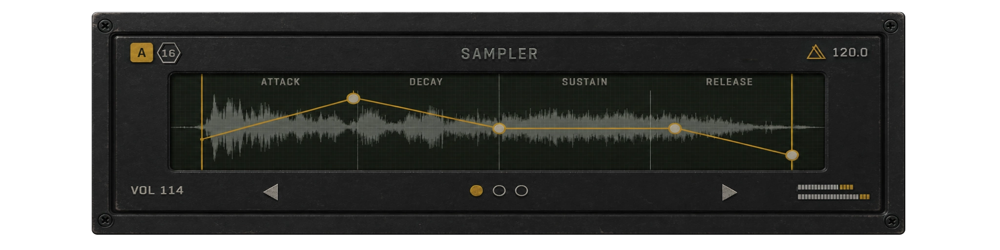
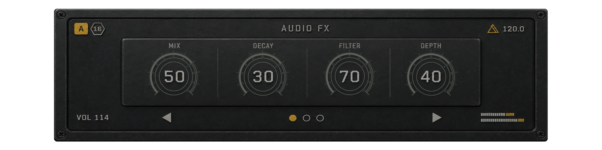

# Vrisso Studio

Vrisso Studio is an exploratory portfolio for original work in audio technology and product design. It presents the products, prototypes, research, and creative work being developed through Vrisso Audio LLC.

## Visit Vrisso Studio

[Explore the Vrisso Studio website](https://vrisso-studio.onrender.com)

## Overview

Vrisso Studio documents the development of browser-based audio software, DSP systems, audio-education tools, embedded electronics, sampler-based instruments, and purpose-built guitar hardware.

The website brings these projects together through field notes, interactive concepts, audio demonstrations, interface studies, and product-development updates.

## Screenshots

### Vrisso Studio

### WAV Guitar Build

### WAV Sampler Engine

### WAV FX Suite

### WAV Guitar Theory

## UI Concepts

### WAV Sampler Interface

### WAV Audio FX Interface

## Featured Projects

### WAV Guitar Build

A purpose-built guitar concept designed to combine traditional guitar performance with sampling, sequencing, modulation, effects, and integrated hardware controls.

### WAV Sampler Engine

An embedded sampler system in development for real-time guitar performance, live processing, looping, clip capture, playback, and Euclidean sequence composition.

### WAV FX Suite

A performance-focused DSP environment designed around a flexible processing chain with effects for color, compression, pitch, filtering, modulation, delay, and reverb.

### WAV Guitar Theory

An interactive learning and composition application that helps guitarists explore notes, chords, scales, progressions, genre, and mood through a playable visual interface.

[Launch WAV Guitar Theory](https://wav-guitar-theory.onrender.com)

## Areas of Focus

- Audio software development
- Digital signal processing
- Sampler-based instruments
- Embedded audio systems
- Specialized guitar builds
- Music-theory and education tools
- Interactive product interfaces
- Real-time audio processing
- Hardware and software integration
- Product research and prototyping

## Additional Content

Vrisso Studio also includes:

- Interactive sampler and effects concepts
- Audio-processing demonstrations
- Original music and production clips
- Product field notes
- Interface and hardware studies
- Ongoing research into audio tools for guitarists

## Development and Collaboration

Vrisso Studio was founded by Will Vrisso and has been in active product development since November 2025.

As founder and audio technology developer, Will leads product strategy, requirements, design direction, Agile planning, testing, and release decisions. Products are developed collaboratively with a contracted senior full-stack engineer.

## Project Status

Vrisso Studio is an evolving portfolio. Some projects are available as live applications, while others represent active research, prototypes, interface concepts, or products in development.

## Repository Scope

This repository is a public showcase of the Vrisso Studio website and its projects. The complete production source, proprietary DSP work, product research, and unreleased development materials are maintained privately.

## Contact

For professional opportunities, development collaboration, or project inquiries:

- [Vrisso Studio](https://vrisso-studio.onrender.com)
- [WAV Guitar Theory](https://wav-guitar-theory.onrender.com)
- [LinkedIn](https://www.linkedin.com/in/william-m-vrisso/)

## Copyright

© 2026 Vrisso Audio LLC. All rights reserved.

This repository and its included media are provided for portfolio and evaluation purposes. No permission is granted to copy, redistribute, or create derivative works without written authorization.
